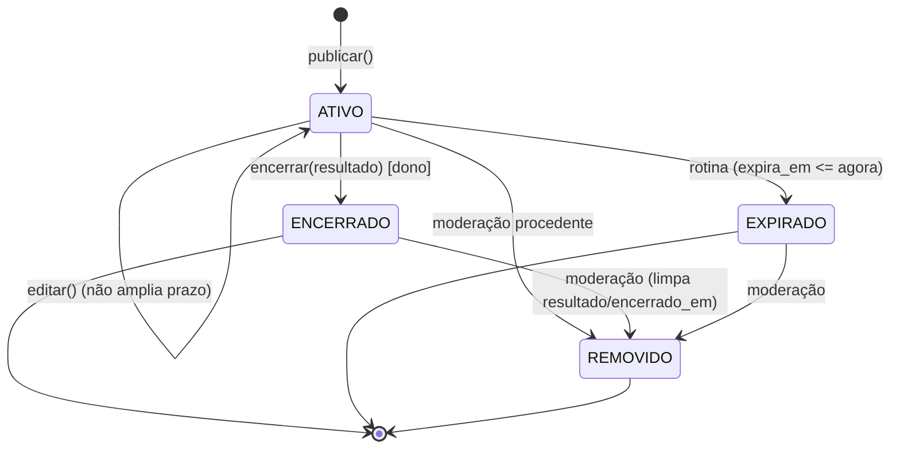

# 03 — Modelo de dados, entidades e estados

> O schema físico **já está definido** em `src/main/resources/db/migration/V1__schema.sql`, que é o `01_schema.sql` do projeto sem `BEGIN/COMMIT`, porque o Flyway já controla a transação.
> **Nunca alterar uma migração já aplicada.** Mudança de schema = nova migração `V{n}__descricao.sql` + atualização deste arquivo e do diagrama.

## 1. Tabelas (resumo; detalhes no SQL)

| Tabela | PK | Relações | Observações |
|--------|----|----------|-------------|
| usuario | uuid (gerado no Java) | — | e-mail único por `lower(email)`; CHECK de WhatsApp; `aceite_contato_em` exige WhatsApp |
| bairro | bigint identity | — | município fixo "Blumenau" |
| categoria | bigint identity | — | 4 linhas fixas inseridas pela V1 |
| anuncio | uuid | usuario, bairro, categoria (N:1) | CHECKs de preço, estado/encerramento, resultado × modalidade, `excedente_declarado = true` |
| denuncia | uuid | anuncio (N:1), autor (N:1), moderador (N:0..1) | CHECK ABERTA/RESOLVIDA; índice único parcial `(anuncio_id, autor_id) WHERE status='ABERTA'` |
| foto (V3) | uuid | anuncio (1:0..1, `anuncio_id UNIQUE`) | `bytea` de até 2 MB; `tipo` image/jpeg ou image/png. `anuncio.foto_url = '/fotos/{foto.id}'` |

Sem exclusão física e sem `ON DELETE CASCADE`. Moderação apenas muda estados.

## 2. Enums (Java `enum`, gravados como texto com `@Enumerated(EnumType.STRING)`)
```java
enum Papel { USUARIO, ADMIN }
enum TipoParticipante { MORADOR, PEQUENO_PRODUTOR }
enum Modalidade { DOACAO, VENDA }
enum Unidade { KG, UNIDADE, LITRO, MACO, DUZIA }   // inteiras: UNIDADE, MACO, DUZIA
enum StatusAnuncio { ATIVO, ENCERRADO, REMOVIDO, EXPIRADO }
enum Resultado { DOADO, VENDIDO, NAO_INFORMADO }
enum StatusDenuncia { ABERTA, RESOLVIDA }
```
Sugestão: `Unidade.isInteira()` e `Resultado.compativelCom(Modalidade)` como métodos dos próprios enums.

## 3. Mapeamento JPA (regras obrigatórias)
- `@Id @GeneratedValue(strategy = GenerationType.UUID) UUID id` em Usuario, Anuncio e Denuncia; `@GeneratedValue(strategy = GenerationType.IDENTITY) Long id` em Bairro e Categoria.
- Datas-hora: `Instant` ↔ `timestamptz`. Datas: `LocalDate` ↔ `date`. Dinheiro e quantidade: `BigDecimal` com `precision`/`scale` iguais aos do SQL.
- `spring.jpa.properties.hibernate.jdbc.time_zone=UTC` e `spring.jpa.open-in-view=false`.
- Associações `@ManyToOne(fetch = FetchType.LAZY, optional = false)`. Nenhuma `@OneToMany` é necessária (YAGNI).
- `criado_em` e `atualizado_em` são preenchidos **pelo Java** (com o `Clock`), não pelo `DEFAULT now()`, porque o CHECK `expira_em > criado_em` depende do mesmo relógio.
- `ddl-auto=validate`: se a entidade divergir do SQL, a aplicação **não sobe**. Isso é intencional.
- **Foto** é uma entidade separada (`Foto`: `id`, `UUID anuncioId`, `tipo`, `tamanho`, `byte[] conteudo`, `criadoEm`), para que buscar anúncios **nunca carregue os bytes**. O campo `byte[] conteudo` é mapeado **sem `@Lob`**: no PostgreSQL, `@Lob` vira `oid` e quebra o `validate`; `byte[]` simples vira `bytea`.
- **Troca de foto:** `fotoRepository.deleteByAnuncioId(id)` → **`flush()`** → `save(novaFoto)`. O flush é obrigatório porque o Hibernate executa INSERTs antes de DELETEs e violaria o `UNIQUE(anuncio_id)`.
- Atomicidade (UC06): anúncio e foto são gravados na **mesma transação**. Se algo falhar, não sobra foto órfã, sem nenhum código extra.

## 4. Entidades com comportamento (fiéis ao diagrama de classes)
Os métodos abaixo **existem na entidade** e contêm as regras de transição. Os serviços orquestram (carregar, autorizar, salvar) e **não** repetem a regra.

```text
Usuario
  + atualizarPerfil(nome, tipo, whatsapp, aceiteContato, agora)  // RN02
  + bloquear()                                                   // ativo=false; idempotente
  + podePublicar(): boolean                                      // ativo && whatsapp != null && aceite != null
  + isAdmin(): boolean

Anuncio
  + static publicar(autor, dados, agora, hoje): Anuncio          // RN03–RN07, status ATIVO
  + editar(dados, agora, hoje)                                   // exige ATIVO e não vencido; RN07 sem ampliar prazo
  + encerrar(resultado, agora)                                   // RN09
  + expirar(agora)                                               // ATIVO → EXPIRADO (usado em testes; a rotina usa UPDATE em lote)
  + remover(agora)                                               // RN11
  + estaVisivel(agora, hoje): boolean                            // RN08
  + pertenceA(usuarioId): boolean

Denuncia
  + static abrir(anuncio, autor, motivo, agora)                  // RN10.1–4
  + resolver(decisao, moderador, agora)                          // ABERTA → RESOLVIDA
```
Violação de regra na entidade lança `RegraNegocioException(codigo, campo?, mensagem)` ou `EstadoInvalidoException`. O handler global converte em HTTP (ver 04_API §2).

## 5. Máquina de estados do anúncio

Qualquer outra transição: `EstadoInvalidoException` → 409.

## 6. Máquina de estados da denúncia
`ABERTA --resolver(decisao, moderador)--> RESOLVIDA` (final). Não existe reabertura.

## 7. Consultas e índices
| Uso | Implementação | Índice existente |
|-----|---------------|------------------|
| Busca pública | `AnuncioRepository extends JpaRepository, JpaSpecificationExecutor` + `AnuncioSpecs.visivel(...)` `.and(texto)` `.and(bairro)` `.and(categoria)` `.and(modalidade)`; ordenação `criadoEm DESC, id DESC` | `ix_anuncio_busca` |
| Texto | `lower(titulo) LIKE %t%` OR `lower(descricao) LIKE %t%`, com `t` minúsculo, sem espaços nas pontas e com `%` e `_` escapados | — (aceitável no volume do MVP) |
| Meus anúncios | `findByUsuarioIdOrderByCriadoEmDesc(id, pageable)` | `ix_anuncio_usuario` |
| Expiração | `@Modifying @Query("update Anuncio a set a.status = EXPIRADO, a.atualizadoEm = :agora where a.status = ATIVO and a.expiraEm <= :agora")` | `ix_anuncio_expira` |
| Transições | `@Lock(PESSIMISTIC_WRITE) @Query("select a from Anuncio a where a.id = :id") Optional<Anuncio> findByIdParaAtualizar(UUID id)` | PK |
| Fila admin | `findByStatusOrderByCriadoEmAsc(StatusDenuncia, pageable)` (mais antigas primeiro) | `ix_denuncia_status` |
| Duplicidade | `existsByAnuncioIdAndAutorIdAndStatus(anuncioId, autorId, ABERTA)` + captura de `DataIntegrityViolationException` do índice único → 409 | `uq_denuncia_aberta` |
| E-mail | `findByEmailIgnoreCase` / `existsByEmailIgnoreCase` + captura da violação de `uq_usuario_email` → 409 | `uq_usuario_email` |

Busca, detalhe e meus anúncios carregam `categoria`, `bairro` e `usuario` com `@EntityGraph` para evitar N+1.

## 8. Migrações
| Arquivo | Conteúdo |
|---------|----------|
| `V1__schema.sql` | Schema do projeto + 4 categorias |
| `V2__seed_bairros.sql` | 35 bairros de Blumenau (D17) |
| `V3__foto.sql` | Tabela `foto` (E09/D13) |

Usuários de demonstração **não** entram em migração. Use o perfil `demo` (05_ARQUITETURA §7) com senhas vindas de variáveis de ambiente.
